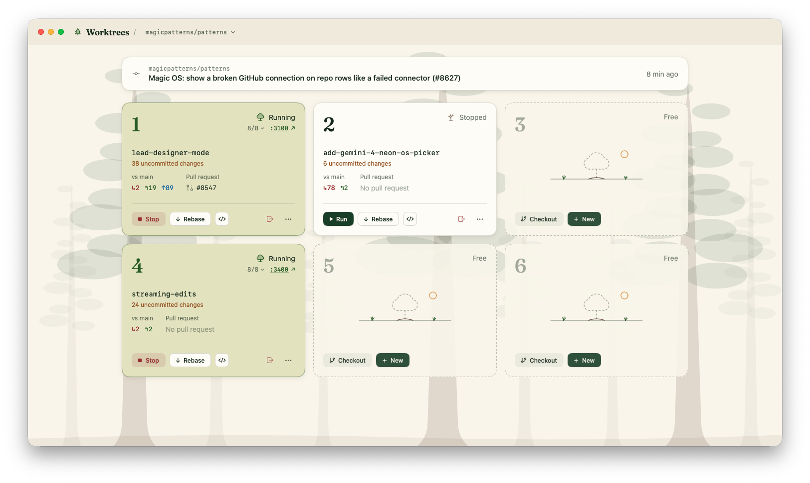

# Tree Yard

A native Mac app for a pool of git worktrees. Point it at a folder of worktrees and each one becomes a
numbered slot showing its branch, how far it is from main, its pull request, and whether its dev stack is
running. From a slot you can run or stop the stack, rebase, switch or create a branch, open the editor, and
release the slot.



## Contents

- [Quick start](#quick-start)
- [Requirements](#requirements)
- [The worktree directory](#the-worktree-directory)
- [Configure a pool: `treeyard.json`](#configure-a-pool-treeyardjson)
- [Setting up a new pool (for agents)](#setting-up-a-new-pool-for-agents)
- [Using the app](#using-the-app)
- [How state is detected](#how-state-is-detected)
- [Troubleshooting](#troubleshooting)
- [Development](#development)
- [License](#license)

## Quick start

```sh
./scripts/build-app.sh
open "build/Tree Yard.app" --args ~/worktrees/my-app
```

The path is optional. Without it the app opens the last folder it used, or asks for one. Switch folders from
the repo name in the title bar, or with ⌘O.

Run and Stop need a `treeyard.json` in the worktree directory. See
[Configure a pool](#configure-a-pool-treeyardjson).

## Requirements

| Needed                     | For                                                              |
| -------------------------- | ---------------------------------------------------------------- |
| macOS 14 or later          | Running the app.                                                 |
| Xcode Command Line Tools   | Building. Xcode itself is not needed (`xcode-select --install`). |
| `git`                      | Everything.                                                      |
| `gh`, signed in (optional) | Pull request status. Without it, tiles show "No pull request".   |
| `treehouse` (optional)     | Lease names on tiles, when the folder is a treehouse pool.       |

## The worktree directory

The folder you open is the pool. Each direct subfolder of the pool is one slot, and a slot must be either a
git checkout itself or hold one exactly one level down.

```
my-app-pool/            <- the pool: open this folder
  1/                    <- a slot; its folder name is the slot's name
    my-app/             <- the checkout (has a .git file or folder)
  2/
    my-app/
  treeyard.json         <- how to run things in this pool
```

**The rules**

- **Slot name.** The slot folder's name is the tile's label and the value of `{slot}`. The checkout folder's
  name is never read, so it can be anything.
- **Depth.** The checkout is the slot folder or a direct child of it. Anything deeper is not found.
- **Checkout.** Any folder with a `.git` entry counts: a worktree, a full clone, or a mix of both in one pool.
- **Order.** Slots are sorted by name, with numbers in numeric order (`2` before `10`). `{index}` is the
  slot's 1-based position in that order.
- **Ignored.** Hidden folders, plain files, and subfolders with no checkout are skipped.
- **Rescanned.** The pool is re-read every 15 seconds, so added, removed or renamed slots show up without a
  restart.

**Valid layouts**

```
# Numbered slots, checkout named after the repo (treehouse's default)
pool/1/my-app/
pool/2/my-app/

# Numbered slots, checkout named <slot>-<repo> or <repo>-<slot>
pool/1/1-my-app/
pool/2/my-app-2/

# Flat: each slot folder is itself the checkout
pool/1/
pool/2/

# Named slots
pool/alpha/my-app/
pool/beta/my-app/
```

With named slots, `{slot}` is `alpha`, so a template such as `"port": "3{slot}00"` no longer makes a port.
Use `{index}` there instead: `"port": "3{index}00"`.

**Layouts that don't work**

```
# Too deep: the checkout is two levels below the slot
pool/1/src/my-app/

# Flat with the repo in the name: it works, but the slot is "1-my-app", not "1"
pool/1-my-app/

# Outside the pool: only subfolders of the opened folder are scanned
~/code/my-app-1/
~/code/my-app-2/
```

For the last case, open the parent folder (`~/code`) as the pool instead. Every checkout in it becomes a slot.

**Treehouse pools.** A [treehouse](https://github.com/kunchenguid/treehouse) pool
(`~/.treehouse/<repo>-<hash>`) works as it is, including with `unique_leaf` or a `worktree_path` that keeps
the numbered slot folder, such as `{pool}/{slot}/{slot}-{repo}`. A `worktree_path` that drops the slot folder
or leaves the pool falls under the layouts above that don't work. Leases from `treehouse-state.json` are
shown on the tiles.

A slot with a detached HEAD is shown as free.

## Configure a pool: `treeyard.json`

One file per pool, in the worktree directory, next to the slot folders. Every key is optional, and the file
is re-read every 15 seconds, so edits apply without a restart.

```json
{
  "start": "WORKTREE_ID={slot} yarn dev",
  "stop": "WORKTREE_ID={slot} yarn dev:kill",
  "port": "3{slot}00",
  "release": "treehouse return --force {path}",
  "services": [
    { "name": "web", "port": "3{slot}00" },
    { "name": "api", "port": "3{slot}01" }
  ]
}
```

| Key        | What it does                                                                                              |
| ---------- | --------------------------------------------------------------------------------------------------------- |
| `start`    | Starts the dev stack. Runs in the slot's worktree and must stay in the foreground.                        |
| `stop`     | Stops it, run in the same worktree. Without it, Tree Yard signals the start command's process group.      |
| `port`     | The slot's main web port. The slot shows as running while this port is open, and the tile links to it.    |
| `url`      | What the port link opens. Defaults to `http://localhost:{port}`.                                          |
| `services` | List of `{"name", "port"}`. The tile shows how many are up, with the full list on click.                  |
| `release`  | Frees a slot, run in the pool folder. Without it, Tree Yard stashes tracked changes and detaches at main. |
| `editor`   | Opens the worktree in an editor. Defaults to VS Code.                                                     |

**Placeholders**, filled per slot in every value:

| Placeholder | Value                                          |
| ----------- | ---------------------------------------------- |
| `{slot}`    | The slot's folder name, such as `2`.           |
| `{index}`   | Its 1-based position in the pool.              |
| `{port}`    | The slot's `port`, once expanded.              |
| `{path}`    | The worktree's path, shell-quoted in commands. |

Commands also get `TREEYARD_SLOT`, `TREEYARD_INDEX`, `TREEYARD_PORT` and `TREEYARD_PATH` in their
environment.

**How commands run.** Each command runs with `/bin/zsh -c` and the `PATH` of your interactive shell, captured
once when the app launches. Tools resolve as they do in a terminal, including a Node version set in
`.zshrc`. Restart the app after changing your shell's `PATH`.

## Setting up a new pool (for agents)

If you are an agent asked to make Run and Stop work for a pool, write `<pool>/treeyard.json` by following
these steps. Pressing Run in a pool with no `start` command shows the same task as a prompt to copy.

1. **Find how the repo starts its dev stack.** Read `package.json` scripts, a `Makefile`, `Procfile`, or
   the repo's README in any slot's worktree.
2. **Give each slot its own ports.** Several slots run at once, so the start command must not use fixed
   ports. Look for an existing per-worktree scheme (an env var such as `WORKTREE_ID` or `PORT`) and drive
   it with `{slot}` or `{index}`. If the repo has none, pass a port derived from the slot, such as
   `PORT=30{slot}0`.
3. **Set `start`** to a command that stays in the foreground. Don't background it with `&`.
4. **Set `port`** to the main web server's port for the slot. This is what marks a slot as running.
5. **Set `stop`** if the repo has a kill script. Otherwise leave it out and Tree Yard signals the process
   group that `start` created.
6. **Set `services`** if the stack has several servers, one entry per port, so a half-started stack is
   visible.
7. **Set `release`** only if the pool has its own way to return a slot, such as `treehouse return`.
8. **Check it.** Run the expanded `start` command by hand in one slot and confirm the port opens:

   ```sh
   lsof -nP -iTCP:<port> -sTCP:LISTEN
   ```

   Then run the `stop` command and confirm the port closes.

Don't put secrets in `treeyard.json`.

## Using the app

**A free slot** has two buttons:

- **Checkout** picks an existing branch to check out in the slot.
- **New** creates a branch from `origin/main`, fetched first, and checks it out.

**An occupied slot** has:

| Control             | What it does                                                                                  |
| ------------------- | --------------------------------------------------------------------------------------------- |
| Run / Stop          | Starts or stops the dev stack. Stop also cancels a start that is stuck.                       |
| Rebase              | Fetches main and runs `git rebase --autostash` onto it. On conflicts it aborts and tells you. |
| `</>`               | Opens the worktree in the editor.                                                             |
| Release (exit icon) | Stops the stack, then runs `release`, or stashes tracked changes and detaches at main.        |
| ⋯                   | Change branch, Show in Finder, Show start log.                                                |
| `:3100 ↗`           | Opens the running stack in the browser.                                                       |
| `8/8 ⌄`             | Lists each service with its state and port. Amber when a running stack is missing one.        |
| Pull request        | Opens the pull request on GitHub.                                                             |

Changing branch stashes tracked changes first, and restarts a running stack on the new branch.

**The "vs main" counts** use the same glyphs as a git prompt, each shown only when above zero:

| Glyph | Meaning                                           |
| ----- | ------------------------------------------------- |
| `↳3`  | 3 commits on `origin/main` that the branch lacks. |
| `↰2`  | 2 commits on the branch that `origin/main` lacks. |
| `↑1`  | 1 commit not yet pushed to the branch's upstream. |

⌘R refreshes everything now. ⌘O opens another directory.

## How state is detected

| What                    | How                                | Refreshed        |
| ----------------------- | ---------------------------------- | ---------------- |
| Stack and service state | Whether the port is open (`lsof`). | Every 3 seconds  |
| Branch, changes, counts | `git status` and `git rev-list`.   | Every 15 seconds |
| Pull requests           | `gh`.                              | Every 2 minutes  |
| `origin`                | `git fetch origin`.                | Every 5 minutes  |

Because running is detected from the port, a stack started in a terminal shows as running too, and Stop
works on it. Stacks keep running when the app quits.

## Troubleshooting

**A slot is stuck on "Starting…".** The start command is running but the main port never opened. Open the
log from ⋯ > Show start log, or read it directly:

```sh
tail -f ~/Library/Logs/TreeYard/<pool>-<slot>.log
```

The log is overwritten on each Run. Press Stop to cancel the start, fix the cause, and Run again. A common
cause is a secrets or login tool that has been signed out.

**The service count is short, such as `7/8`.** Click it to see which port is closed, then check the log for
that service.

**The wrong Node or tool version runs.** Commands use the `PATH` captured at launch. Quit and reopen the app
after changing your shell setup.

**Tiles show "No pull request" for branches that have one.** Check `gh auth status`.

**Watchers survive Stop.** A `stop` command that only kills port listeners leaves processes without a port,
such as file watchers, running. Kill them by hand, or make the `stop` command cover them.

## Development

The app is SwiftUI, built with SwiftPM alone.

```sh
./scripts/build-app.sh          # build/Tree Yard.app
./scripts/build-app.sh debug    # build/Tree Yard Debug.app, with the hooks below
```

With only the Command Line Tools installed, the script builds against the macOS 26 SDK, because the macOS 27
SDK needs a compiler plugin that ships with Xcode.

| File                              | Holds                                                          |
| --------------------------------- | -------------------------------------------------------------- |
| `Sources/TreeYard/App.swift`      | Entry point, window, menu commands, app icon.                  |
| `Sources/TreeYard/Store.swift`    | App state, polling, and every action (start, stop, rebase, …). |
| `Sources/TreeYard/Model.swift`    | `Slot`, `treeyard.json` parsing, git and `gh` queries.         |
| `Sources/TreeYard/Shell.swift`    | Running commands and spawning the dev stack.                   |
| `Sources/TreeYard/Views.swift`    | Window layout, title bar, empty states.                        |
| `Sources/TreeYard/SlotTile.swift` | The slot tile and its parts.                                   |
| `Sources/TreeYard/Dialogs.swift`  | Branch, release and setup dialogs.                             |
| `Sources/TreeYard/Theme.swift`    | Colours, fonts, button style, dropdown menu.                   |
| `Sources/TreeYard/SVG.swift`      | The illustrations and glyphs.                                  |

**Checking the app without the pointer.** The debug build has two hooks, set as environment variables on the
binary:

```sh
TREEYARD_SNAPSHOT=/tmp/yard.png \
TREEYARD_SCRIPT="start:1,sleep:8,menu:services,sleep:5,stop:1" \
"build/Tree Yard Debug.app/Contents/MacOS/TreeYard" /path/to/pool
```

- `TREEYARD_SNAPSHOT` writes a picture of the window to that path every two seconds.
- `TREEYARD_SCRIPT` runs comma-separated steps against the store: `start:<slot>`, `stop:<slot>`,
  `rebase:<slot>`, `switch:<slot>:<branch>`, `create:<slot>:<branch>`, `release:<slot>`,
  `menu:tile|header|services`, `dialog:branch|new|release|setup:<slot>`, and `sleep:<seconds>`.

The debug and release builds share settings, so the debug build changes which folder the release build opens
next.

## License

Tree Yard is released under the [MIT License](LICENSE). The bundled Fraunces font is licensed separately
under the [SIL Open Font License](Resources/Fraunces-OFL.txt).
